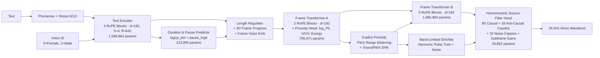

# 03 · `tiny-voca` (4.5M) & 2026 Tiny TTS SOTA Deep Dive: Why Homomorphic Source-Filter Beats Neural Vocoders Below 15M Params

To understand why **`n4ze3m/tiny-voca`** (`4,537,291` parameters, 2 voices `F2` & `M2`, `18.2 MB` FP32, `70×` real-time on CPU, `#5` and `#7` on the November 2026 Open TTS Leaderboard with `0.74%` WER and `4.43` UTMOS22), **`RL10x/tiny-voca-hindi`** (`9.7M` parameters, `#1` of 16 Hindi models on the Open TTS Leaderboard, trained on `ai4bharat/Rasa`), and **`77ethers/alpa`** (`4.5M` parameters, Female & Male Sanskrit voices, trained on `ai4bharat/Rasa`) sound so clean, clear, and stable at `4.5M–9.7M` parameters, we cloned `n4ze3m/tiny-voca` and inspected every line of `src/tiny_voca/{model,train,losses,align,refine,export,prepare}.py`.

---

## 1. Exact Architecture of `tiny-voca` (`4,537,291` Parameters)



### 1.1 Why `tiny-voca`'s Transformer Stack Has Zero Compression Hacks
Every single block in `tiny-voca` (`encoder`: 4 layers, `prosody_stack`: 2 layers, `acoustic_stack`: 5 layers = **11 Transformer blocks total**) is a **full-rank Pre-Norm RoPE Transformer + Depthwise Conv (`k=7`) + Dense `192 -> 640 -> 192` GELU FFN** (`src/tiny_voca/model.py:67–88`):
```python
class Block(nn.Module):
    def __init__(self, c):
        super().__init__()
        self.norm1 = nn.LayerNorm(c.channels)                           # 192
        self.attention = Attention(c.channels, c.heads, c.dropout)      # 4 heads, RoPE
        self.norm2 = nn.LayerNorm(c.channels)
        self.depthwise = nn.Conv1d(c.channels, c.channels, 7, padding=3, groups=c.channels)
        self.expand = nn.Linear(c.channels, c.feedforward)              # 192 -> 640 (dense!)
        self.project = nn.Linear(c.feedforward, c.channels)             # 640 -> 192 (dense!)
```
- **No SVD truncation, no Walsh-Hadamard rotations, no Monarch block-diagonal MLPs, and no multi-step ODE loop.**
- Because it runs in **1 deterministic pass** instead of 4 or 8 ODE steps, a 5-block Frame Transformer B with `d=192, ff=640` and full-utterance RoPE self-attention uses **fewer FLOPs** than a 4-step ConvNeXt ODE loop while having an **infinite (full-sentence) receptive field** instead of `512 ms`!

---

## 2. The Physics of the 25,862-Parameter Homomorphic Source-Filter Head (`SourceFilter`)

Why does replacing a `5M–13.5M` neural vocoder with a `25,862`-parameter `SourceFilter` (`src/tiny_voca/model.py:129–250`) eliminate metallic buzz and phase warble?

### 2.1 Closed-Form Band-Limited Dirichlet Harmonic Oscillator (`pulse_train`)
Instead of summing $K=8$ truncated sinusoids (`VocoderV2`) or asking a ConvNeXt network to guess 513 STFT phases from a mel spectrogram (`Vocos-24kHz`), `tiny-voca` uses the exact trigonometric identity for the sum of all unit-amplitude cosine harmonics up to Nyquist ($K(t) = \lfloor 0.47 \cdot f_s / f_0(t) \rfloor$, $N_{\text{whole}} = \lfloor K(t) \rfloor$):
$$\sum_{k=1}^{N_{\text{whole}}} \cos(k\theta) = \frac{\sin\left((N_{\text{whole}} + \tfrac{1}{2})\theta\right)}{2\sin(\theta / 2)} - \frac{1}{2}$$
with fractional top-harmonic fade-in $(K(t) - N_{\text{whole}})\cos((N_{\text{whole}}+1)\theta)$ so that as pitch $f_0(t)$ glides up or down, the highest harmonic near $11.28\text{ kHz}$ fades in and out continuously with **zero aliasing clicks** and **zero neural parameters**!
In ONNX/WebAssembly (`src/tiny_voca/export.py:179–202`), phase accumulation is computed in 32-bit float within each 256-sample frame and accumulated across frames as **exact 24-bit integer cycle fractions (`1 << 24`)**, guaranteeing zero float32 phase drift even on 30-second paragraphs in browser WASM.

### 2.2 Minimum-Phase + Maximum-Phase Complex Cepstrum (`cepstrum_response`)
A human vocal tract filter has two physical components:
1. **Vocal Tract Resonances (Formants $F_1..F_5$)**: Minimum-phase poles inside the unit circle, represented by **causal cepstral coefficients** `c[0 .. cep_causal-1]` (`cep_causal = 80` on `synth_fft = 512`, covering quefrencies $0 \dots 3.33\text{ ms}$).
2. **Glottal Pulse Open/Return Phase**: Maximum-phase zeros outside the unit circle (the rounded glottal opening before rapid glottal closure), represented by **anti-causal cepstral coefficients** `c[synth_fft - cep_anti .. synth_fft - 1]` (`cep_anti = 16`, covering $-0.67 \dots 0\text{ ms}$).

By predicting `[cep_causal=80, cep_anti=16]` per frame and taking:
$$H(\omega) = \exp\left(\text{rFFT}(\text{cepstrum})\right) = \exp\left(\text{Re}\right) \cdot e^{i \cdot \text{Im}}$$
the network **automatically satisfies minimum/maximum-phase Kramers-Kronig dispersion relations**! It never predicts unconstrained bin-by-bin phases that cause hollow phase cancellation or metallic comb ringing.

### 2.3 Sub-Frame Gain Resolution (`5.33 ms` Harmonic, `2.67 ms` Noise)
Within each `256`-sample (`10.67 ms`) acoustic frame:
- The **harmonic cepstrum** is linearly interpolated to `synth_hop = 128` (`5.33 ms`, `harmonic_steps = 2` sub-frame gains per frame).
- The **noise cepstrum** (`noise_cep = 32` on `noise_fft = 256`) has **`noise_steps = 4` independent sub-frame log-gains per frame (`noise_hop = 64` = `2.67 ms` resolution)**!
- This `2.67 ms` noise envelope control is why plosive bursts (`त, थ, ट, ठ, क, ख, प, फ`) and affricate releases (`च [ts], छ [tsʰ]`) are razor-sharp without needing a `1.5 ms` neural vocoder upsampler.

---

## 3. Five Crucial Training & Alignment Innovations in `tiny-voca` (`train.py` & `align.py`)

Reading `src/tiny_voca/train.py`, `align.py`, `refine.py`, and `docs/annotations-v3.md` reveals **five training secrets** that `Sakhiya` never used:

1. **Ground-Truth F0 Drives the Oscillator During Waveform Loss (`train.py:85`)**:
   ```python
   # The oscillator always follows the recorded pitch here, because the waveform target does.
   wave = m.vocoder(acoustic, m.frequency(target[..., 0]), lengths, phase=phase)
   stft, mel = self.spectral(wave, batch["wave"], lengths * c.hop)
   ```
   Because `m.vocoder` is driven by the **recorded pitch `target[..., 0]`** during training, the synthesized harmonics $k \cdot f_0^{\text{GT}}(t)$ align bin-for-bin with the ground-truth recording `batch["wave"]`! Thus, the STFT and GAN losses **never punish the acoustic decoder for pitch differences** and **never blur the harmonics** (solving Root Cause 2 completely).

2. **Scheduled Prosody Teacher-Forcing Annealing (`teacher_probability`, `train.py:79–80, 121–124`)**:
   - For steps `0 .. 3,000` (`teacher_hold`), Frame Transformer B is conditioned `100%` on ground-truth `(pitch, voicing, energy)`.
   - From step `3,000 .. 10,000` (`teacher_ramp`), `teacher_probability` ramps linearly from `1.0` down to **`0.0`** (`teacher_final = 0.0`).
   - From step `10,000 .. 100,000+`, Frame Transformer B is conditioned **`100%` on the model's own detached prosody predictions `m.hard_prosody(prediction.detach())`**, guaranteeing zero train-inference mismatch while the oscillator still uses `target_f0` for waveform comparison!

3. **Global-Variance Pitch-Spread Loss (`pitch_spread`, `train.py:70–76`)**:
   ```python
   # An absolute-error fit alone predicts a flatter contour than people speak
   # (about three quarters of the recorded spread on held-out text). Match each
   # utterance's pitch spread as well, the classic global-variance correction.
   predicted_spread, recorded_spread = masked_std(prediction[..., 0], sung), masked_std(target[..., 0], sung)
   pitch_spread = masked_mean((predicted_spread - recorded_spread).abs(), enough)
   ```
   With weight `2.0`, this single 3-line loss forces every utterance's predicted pitch standard deviation to match real human speech, eliminating flat/monotonous TTS pitch contours!

4. **Automatic Gradient-Norm Balancing Between Reconstruction and GAN (`train.py:151–160`)**:
   ```python
   # Fixed weights cannot balance these terms: measured at the waveform, the
   # adversarial gradient was under 1% of the spectral one, i.e. switched off.
   # Scale the GAN term so that, inside the windows the critics saw, its
   # gradient is `gan_ratio` (0.7) times the reconstruction gradient.
   reconstruction_gradient = torch.autograd.grad(auxiliary["reconstruction"], wave, retain_graph=True)[0].gather(1, index)
   gan_gradient = torch.autograd.grad(gan, wave, retain_graph=True)[0].gather(1, index)
   scale = (recipe["gan_ratio"] * ramp * reconstruction_gradient.norm() / gan_gradient.norm().clamp_min(1e-12)).clamp(max=2000.0).detach()
   loss = loss + scale * gan
   ```
   In `Sakhiya`, GAN weights were hardcoded constants (`0.25`, `0.35`), which either got swamped by `11.0 * l_mel_vc + 8.0 * l_mel_s1` or destabilized training. `tiny-voca` computes the exact $\ell_2$ gradient norm ratio $\frac{\|\nabla_{\text{wave}} \mathcal{L}_{\text{rec}}\|}{\|\nabla_{\text{wave}} \mathcal{L}_{\text{GAN}}\|}$ on the cropped waveform windows and locks the adversarial gradient to `0.7x` of the spectral gradient!

5. **Pretrained CTC Aligner with Empirical Onset Offset + `-45 dB` Silence Pause Attribution (`align.py:158–209`)**:
   - Instead of a self-trained MAS/CTC aligner that collapses or drifts, `tiny-voca` aligns phonemes with a pretrained recognizer, shifts phone onsets by `-19 ms` (calibrated against voicing flips), assigns silent spans (`>= 75 ms` below `P95 - 45 dB`) strictly to explicit pause-capable tokens (`BOS, EOS, punct, |`), and sets non-silent word boundaries `|` to **exact `0` frames** so `duration` + `pause` predictors learn true human phrasing.
